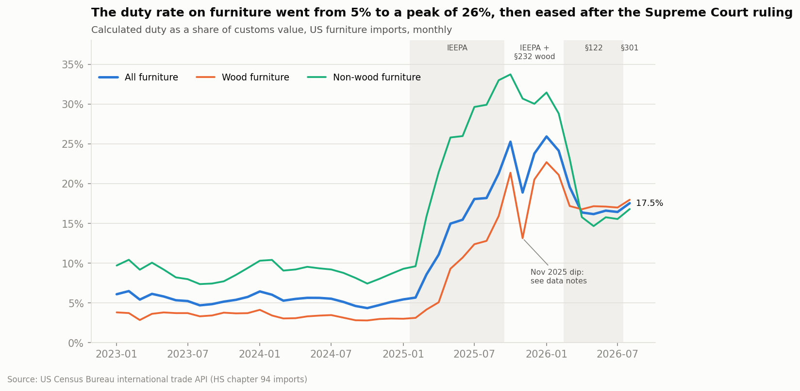
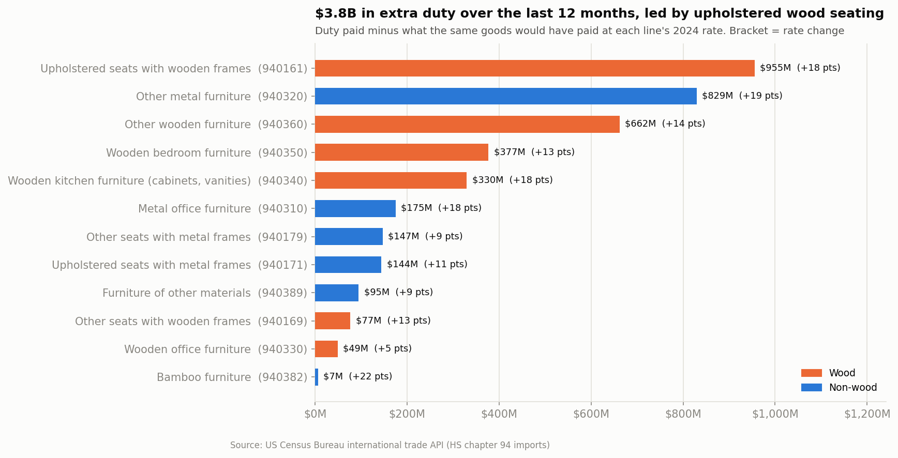
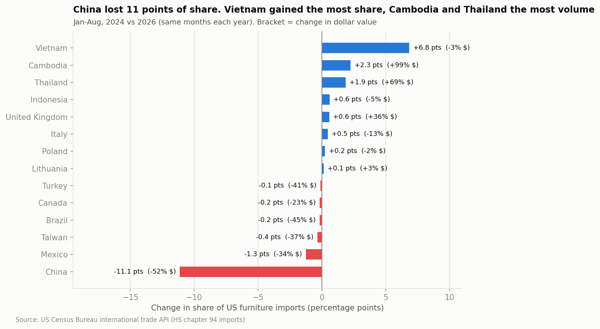
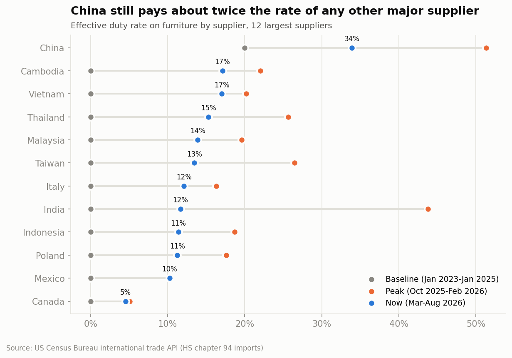
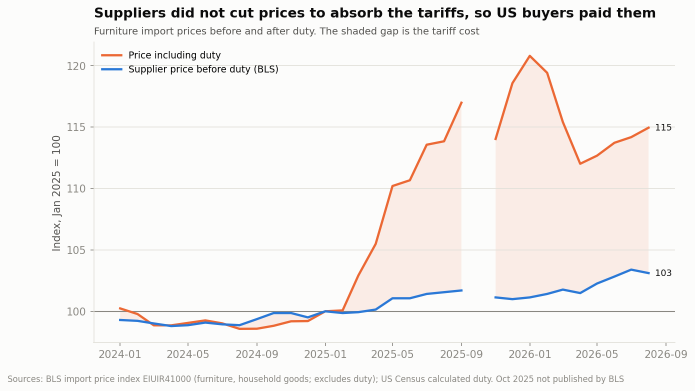

# Furniture tariff exposure

Between February 2025 and August 2026 the tariff rules on imported furniture
changed at least eight times. I wanted to see what that actually did to the
duty US importers paid, using the government's own trade records rather than
headline tariff rates, and then turn it into something a furniture importer
could make a sourcing decision with.

I set it up as if I were the analyst at a mid-size US furniture importer
(about $40M a year of product, a lot of it from China) with three questions
to answer:

1. Which of our product lines are most exposed?
2. Where is the rest of the market moving its sourcing?
3. What would moving our own volume cost or save?

I don't have a real company's data, so the importer is made up. All the
market numbers are real.

The scenario model for question 3 is still in progress.

## The short version

- The effective duty rate on furniture went from 5.3% in 2024 to a peak of
  25.9% in January 2026. It was still 17.5% in August 2026, after the Supreme
  Court threw out the IEEPA tariffs.
- Importers paid $5.2B in duty over the last 12 months, compared with $1.8B
  in all of 2024. About $3.8B of that comes from the higher rates alone.
- Foreign suppliers didn't lower their prices to make up for it. Pre-duty
  import prices have gone up 3.1% since January 2025, so US importers carried
  the cost.
- China's share of US furniture imports fell from 28.2% to 17.0%. Vietnam
  picked up the most share, but Cambodia and Thailand are where volume actually
  grew.

## Background

Four separate tariff programs hit furniture in this window, and they stack
differently on different products:

- **IEEPA tariffs** (Feb 2025 - Feb 2026): a China "fentanyl" tariff, then
  reciprocal tariffs on almost everyone. Struck down by the Supreme Court on
  Feb 20, 2026.
- **Section 232** (from Oct 14, 2025): 25% on certain upholstered wooden
  furniture and on kitchen cabinets and vanities, from every country. Still in
  force; a scheduled increase was pushed to 2027.
- **Section 122** (Feb 24 - Jul 24, 2026): a flat 10% stopgap after the ruling.
- **Section 301** (from Jul 24, 2026): 12.5% on China, Vietnam and Thailand,
  10% on Cambodia, Indonesia, Malaysia, Mexico and others.

Dates and sources are in [docs/tariff_timeline.md](docs/tariff_timeline.md).

## 1. How much more duty is furniture paying?



The rate is calculated duty divided by the customs value of goods entered, so
it captures exemptions, stacking rules and product mix instead of assuming the
headline rate applies to everything.

Non-wood furniture got hit first because it leans much harder on China. In
2024 China supplied 46% of non-wood furniture imports but only 15% of wood
furniture, and China's tariffs went up first and furthest. Wood furniture
caught up in October 2025 when Section 232 started.
From April 2026 on, both have stayed around 15-18%, roughly three times where
they were in 2024.

## 2. Which product lines are most exposed?



"Extra duty" is what each line paid in the last 12 months minus what the same
goods would have paid at that line's 2024 rate. Wood lines account for 64% of
the $3.8B.

Upholstered wood-frame seating (HS 940161) is the most exposed line: $955M in
extra duty, its rate up from 4.8% to 22.6%. Section 232 hits it from every
country, so moving production doesn't escape it. Its China share has already
dropped from 26% to 8%.

## 3. Where is sourcing moving?



Comparing January-August 2026 with the same months of 2024:

- China lost 11.1 points of share and half its dollar volume ($6.2B to $2.9B).
- Vietnam gained the most share (29.7% to 36.6%), but its dollar volume
  actually fell 3%. The total market shrank 21%, so Vietnam's share went up
  even though it didn't pick up China's lost orders.
- Cambodia (+99%) and Thailand (+69%) are where volume really grew.
- Mexico lost share and a third of its volume. I expected to see some
  nearshoring here and it isn't in the furniture numbers, at least not yet.



China still pays about twice the rate of any other big supplier (33.9% since
March 2026, against 17% for Vietnam and Cambodia), because the 2018-19
Section 301 tariffs on Chinese furniture never went away.

## 4. Who paid the tariff?



The BLS import price index measures what foreign suppliers charge *before*
duty. If suppliers were absorbing the tariffs, it would have dropped as the
duty went up. It went up 3.1%. With duty included, the cost of imported
furniture peaked about 21% above January 2025 and is still about 15% higher.

## How the numbers were checked

`src/check_data.py` exits with an error if any of these fail:

- Country rows add back up to the Census world total, for both import value
  and duty, in every month and product line (528 cells each, worst gap 0.0000%).
- No gaps in the 44-month series, no duplicate month/country/product rows, no
  negative values.
- Duty rates fall in a sensible range (10 of 30,012 rows above 100%, all
  shipments under $210K).
- Annual totals are national scale ($30-33B a year for these 12 lines).

## Caveats

- HS6 codes are broad. Rates are averages across everything shipped under a
  code. Section 232 coverage, exclusions and USMCA
  qualification are decided at the 10-digit level or by the specific shipment.
- Census "calculated duty" is what was charged at entry. If the IEEPA refunds
  get paid, the real cost for Feb 2025 - Feb 2026 ends up lower than the data
  shows.
- November 2025 has a one-month drop in duty on upholstered seating and
  cabinets from non-China suppliers, then a full recovery in December. I
  couldn't find a policy change behind it, so it stays in the data and is
  flagged on the chart.
- The BLS series is broader than furniture ("furniture, household goods").
  It is the closest monthly series BLS still publishes. October 2025 is
  missing because BLS didn't publish it.
- Office chairs and sofa beds aren't in the numbers yet. The 2022 HS revision
  split their codes, and the old ones return nothing. The new codes are in the
  fetch script; rerunning it adds them.

## Run it yourself

```bash
python -m venv .venv && source .venv/bin/activate
pip install -r requirements.txt

# optional: re-download the raw data (needs a free Census API key in .env,
# see .env.example). The cleaned data is already in data/processed/.
python src/fetch_census.py
python src/fetch_bls.py
python src/clean.py

python src/check_data.py
python src/run_analysis.py
python src/make_charts.py
```

## The queries

Each query in `sql/` answers one question. `python src/run_analysis.py` runs
them all with DuckDB and saves the results to `output/`.

| Query | Question |
|---|---|
| `01_monthly_duty_burden` | How has the effective duty rate moved month to month, wood vs non-wood? |
| `02_supplier_share_by_year` | Which countries supply US furniture, and how is that changing? |
| `03_duty_rate_by_country` | What rate does each big supplier actually pay, in each policy phase? |
| `04_sourcing_shift` | Who gained and lost share since 2024 (same months each year)? |
| `05_exposure_by_product` | Which product lines picked up the most extra duty? |
| `06_rate_matrix` | Current rate for each supplier and product line |
| `07_price_vs_duty` | Did suppliers cut prices, or did importers pay the tariff? |

## Data sources

- US Census Bureau, [International Trade API](https://www.census.gov/data/developers/data-sets/international-trade.html),
  imports by HS code and country (`timeseries/intltrade/imports/hs`), Jan 2023 - Aug 2026.
- US Bureau of Labor Statistics, [Import/Export Price Indexes](https://www.bls.gov/mxp/),
  series EIUIR41000 and EIUIR.
- Tariff policy sources are listed in [docs/tariff_timeline.md](docs/tariff_timeline.md).
